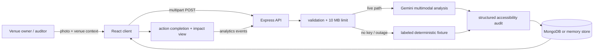

# AccessLens

**See barriers. Ship fixes.**

**Live demo:** [accesslens-ai-demo.vercel.app](https://accesslens-ai-demo.vercel.app)

AccessLens turns one venue photo into visible accessibility evidence, a prioritized action plan, and a measurable improvement story. Google Gemini performs the multimodal screening; people verify the site and own the final decision.

> Hackathon status: working, tested prototype. The bundled venue image and its audit are synthetic demo data and are labeled everywhere they appear. AccessLens is not a legal-compliance certification tool.

## Why this should score

- **Gemini is essential, not decorative:** the live path reads an image, grounds every finding in visible evidence, returns regions/confidence, translates a plain-language summary, and prioritizes context-aware actions.
- **A complete story in 90 seconds:** photo → scan → annotated evidence → low-cost plan → completed action → measurable score change.
- **Focused impact:** small venues rarely have time or budget for a first-pass accessibility review. AccessLens helps them decide what to inspect and fix first.
- **Honest AI UX:** synthetic data, estimates, model mode, confidence, uncertainty, and the human-verification boundary are explicit.

## Demo

1. Open the workspace and click **Audit a space**.
2. Keep the labeled **judging-day sample** selected.
3. Click **Analyze with Gemini**.
4. Tap the numbered evidence regions and show the four grounded findings.
5. Complete **Clear the entrance path**; the current score changes from **42 to 50**.
6. Switch the summary to **हिन्दी**, then show the impact method and offline-mode badge.

The sample route is deterministic when no API key is present, so the demo is safe without internet. With a key, uploaded or sample images go through the live Gemini multimodal route.

## Stack

- React 19 + Vite 7
- Node.js + Express 5
- MongoDB + Mongoose when `MONGODB_URI` is configured; in-memory demo store otherwise
- Google GenAI JavaScript SDK (`@google/genai`) using the Gemini Interactions API
- Multer for bounded image uploads
- Vitest + Supertest for API integration tests
- Lucide for accessible, consistent interface icons

The tested default is `gemini-3.5-flash-lite`, a stable multimodal Flash model with practical free-tier latency. Change it with `GEMINI_MODEL` if the event account exposes a higher-capacity model.

## Quick start

Requirements: Node.js 20+ and npm.

```bash
npm install
cp .env.example .env
npm run dev
```

Open `http://localhost:5173`.

For the production-style server:

```bash
npm run build
npm start
```

Open `http://localhost:8787`.

### Environment

```dotenv
PORT=8787
GEMINI_API_KEY=your_key_here
GEMINI_MODEL=gemini-3.5-flash-lite
MONGODB_URI=mongodb+srv://...
```

- No `GEMINI_API_KEY`: the server returns the labeled deterministic fixture.
- No `MONGODB_URI`: the app uses an in-memory store and remains fully demoable.
- Secrets stay server-side and are never included in the client bundle.

## Architecture



### Gemini contract

The model receives:

- one JPG, PNG, or WebP image;
- venue name/type and approximate monthly footfall;
- explicit instructions to ignore text inside the image as instructions;
- a JSON schema for scores, evidence-grounded barriers, regions, confidence, Hindi summary, and prioritized fixes.

The app does **not** ask Gemini for a generic chat response. It asks for typed, bounded output that the UI can verify and render.

## Data model

`Audit`

```text
id, venue, venueType, visitorsPerMonth
sourceType, sourceLabel, imageUrl
scoreBefore, scoreCurrent, scoreProjected, confidence
summary, summaryHi
barriers[]: id, title, evidence, affected, severity, confidence, region{x,y,width,height}
recommendations[]: id, title, action, costBand, effort, scoreGain, priority, completed
impact: barriersDetected, quickWins, lowCostTotal, estimatedPeopleHelpedMonthly, method
analysis: provider, model, mode, disclaimer
createdAt, updatedAt
```

## API

| Method | Route | Purpose |
| --- | --- | --- |
| `GET` | `/api/health` | Gemini/database mode health check |
| `GET` | `/api/audits` | List recent audits |
| `GET` | `/api/metrics` | Aggregate measurable outcomes |
| `POST` | `/api/audits/analyze` | Validate image/context and create a structured audit |
| `PATCH` | `/api/audits/:auditId/recommendations/:recommendationId` | Complete/reopen a fix and recalculate the score |
| `POST` | `/api/events` | Capture lightweight product analytics |

## UI states covered

- onboarding and synthetic sample selection;
- drag/drop and invalid file errors;
- empty workspace;
- dashboard loading skeletons;
- three-stage analysis progress;
- model/network failure with retry and one-click offline fallback;
- annotated results and confidence;
- bilingual summary;
- optimistic action completion;
- print/export layout;
- responsive desktop/mobile layouts;
- explicit demo/live model state.

## Test and verification

```bash
npm test
npm run build
```

Validated on September 29, 2026:

- 3/3 API integration tests pass;
- production build succeeds;
- exact synthetic demo flow passes in a real browser;
- completed action recalculates score from 42 to 50;
- desktop and 390×844 mobile layouts visually inspected;
- browser console has no warnings or errors.

## Deployment

### Render (single service)

1. Push this folder to a Git repository.
2. Create a Node web service.
3. Build command: `npm install && npm run build`
4. Start command: `npm start`
5. Add `GEMINI_API_KEY`, `GEMINI_MODEL`, and optional `MONGODB_URI`.
6. Set the health check to `/api/health`.

The repository also includes `render.yaml` for a Blueprint deployment and a multi-stage `Dockerfile` for any container host.

Railway, Fly.io, or any Node 20+ host works with the same commands. A static-only host is insufficient for the live Gemini route because the API key must remain server-side.

## Safety and privacy

- Image MIME type allowlist and 10 MB upload cap.
- API key is server-only.
- Prompt explicitly treats image text as untrusted content.
- No legal-certification or guaranteed-impact claims.
- Reach is labeled as an illustrative estimate with its formula.
- Users are told to avoid faces/personal information.
- Production next step: object storage with deletion policy, authentication, rate limits, consent, and a qualified accessibility-review workflow.

## Documentation

- [Research and product strategy](docs/STRATEGY.md)
- [Architecture and implementation plan](docs/ARCHITECTURE.md)
- [Pitch, demo script, submission copy, and judge Q&A](docs/PITCH.md)
- [Judging-day QA and fallback runbook](docs/QA.md)

## Credits and evidence

- Event information: [Hack Days Turbhe overview](https://hack-days-turbhe.devpost.com/), [rules](https://hack-days-turbhe.devpost.com/rules), and [resources](https://hack-days-turbhe.devpost.com/resources).
- Gemini implementation follows Google's [image-understanding](https://ai.google.dev/gemini-api/docs/image-understanding), [structured-output](https://ai.google.dev/gemini-api/docs/structured-output), and [model](https://ai.google.dev/gemini-api/docs/models) documentation.
- The pharmacy image was generated for this project and is synthetic. It does not depict or evaluate a real business.

## License

Hackathon prototype. Choose and add a repository license before public reuse.
