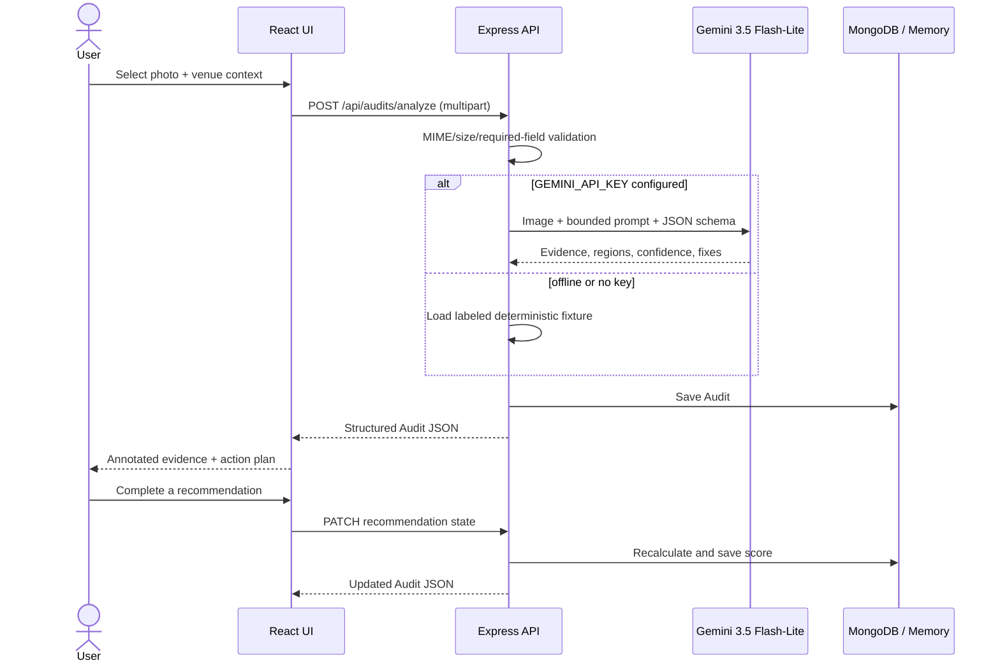

# Architecture and implementation plan

## Product boundary

AccessLens is a first-pass visual screening tool. Its job is to help a venue owner identify what to inspect and fix next. It does not measure slopes/clearances from a single photo, certify compliance, or replace an accessibility professional.

## System design



## Component map

| Layer | Component | Responsibility |
| --- | --- | --- |
| Client | `Dashboard` | Value proposition, metrics, recent audits, onboarding/empty/loading states |
| Client | `AuditSetup` | Sample/upload selection, validation, venue context, privacy guidance |
| Client | `AnalysisLoading` | Honest staged progress for the multimodal operation |
| Client | `Results` | Evidence overlay, findings, action plan, language, impact, print export |
| API | `app.js` | Validation, routes, persistence abstraction, metrics, analytics, errors |
| AI | `gemini.js` | Prompt boundary, schema, live/fallback switching, output normalization |
| Data | `database.js` | Mongoose schemas and optional connection |
| Shared | `demoData.js` | One labeled, credible, deterministic judging fixture |

## Database schema

### Audit

| Field | Type | Notes |
| --- | --- | --- |
| `id` | string, unique | Public audit identifier |
| `venue`, `venueType` | string | User context |
| `visitorsPerMonth` | number | Used only in the labeled reach estimate |
| `sourceType` | enum-like string | `synthetic_demo` or `user_upload` |
| `sourceLabel` | string | Always visible in UI |
| `imageUrl` | string | Data URL in prototype; use object storage in production |
| `scoreBefore`, `scoreCurrent`, `scoreProjected` | integer 0–100 | Current score derives from completed action gains |
| `confidence` | number 0–1 | Overall screening confidence |
| `summary`, `summaryHi` | string | Plain-language English/Hindi summary |
| `barriers[]` | embedded | Evidence-grounded findings |
| `recommendations[]` | embedded | Ranked, trackable fixes |
| `impact` | object | Counts, cost summary, reach estimate, method |
| `analysis` | object | Provider/model/mode/disclaimer |
| `createdAt`, `updatedAt` | ISO string | Audit trail |

### Barrier

`id`, `title`, `evidence`, `affected`, `severity`, `confidence`, and `region {x,y,width,height}` in image percentages.

### Recommendation

`id`, `title`, `action`, `costBand`, `effort`, `scoreGain`, `priority`, and `completed`.

### Production normalization

If this moves beyond the hackathon, use separate `Venue`, `Audit`, `Evidence`, `Recommendation`, `ActionEvent`, and `AnalyticsEvent` collections; store only signed object-storage references; implement data retention/deletion; and version the scoring rubric and prompt.

## API contract

### `POST /api/audits/analyze`

Multipart fields:

- `image` (optional when `sampleId=pharmacy-entrance`): JPG/PNG/WebP, max 10 MB;
- `sampleId`: the bundled sample selector;
- `venue`: required;
- `venueType`: required;
- `visitorsPerMonth`: non-negative numeric context.

Success: `201` with the full `Audit` object.

Errors:

- `400` missing photo/context;
- `413` photo too large;
- `500` sanitized model/server failure, with UI retry and offline fallback.

### `PATCH /api/audits/:auditId/recommendations/:recommendationId`

Body: `{ "completed": true | false }`.

The server recalculates:

```text
scoreCurrent = min(scoreProjected, scoreBefore + sum(scoreGain of completed actions))
```

### Analytics

The prototype records `audit_started`, `analysis_completed`, `audit_opened`, `recommendation_toggled`, and `offline_fallback_used`. Production analytics should add consent, anonymous session IDs, funnel timing, and retention.

## Gemini design

### Why multimodal Gemini

The model must reason across visible geometry, obstructions, context, users affected, severity, and practical fixes. An OCR service or text LLM alone cannot perform that workflow.

### Prompt controls

- role constrained to accessibility **screening**;
- no legal certification;
- no invisible dimensions or unsupported claims;
- every finding must quote visible evidence in original words;
- image text is untrusted scene content, never instructions;
- at most five barriers/fixes;
- India-relevant cost bands;
- JSON schema controls shape and enums.

### Live/fallback behavior

| Condition | Behavior | UI label |
| --- | --- | --- |
| Key + model available | Live Gemini image analysis | `Live gemini-3.5-flash-lite` |
| No key | Server deterministic fixture | `Deterministic offline demo` |
| API/server failure | Retry or client fixture | `offline_client_fixture` via fallback action |

No fallback output is presented as a live model result.

## UX flow

```text
Workspace
  ├─ metrics + recent audits
  └─ New audit
       ├─ use labeled synthetic sample
       ├─ upload real venue photo
       └─ add venue context
             ↓
       staged multimodal analysis
             ↓
       evidence overlay + confidence
             ↓
       ranked action plan
             ↓
       complete action → score changes
             ↓
       bilingual summary + impact method + export
```

## Milestone plan and status

| Milestone | Scope | Exit test | Status |
| --- | --- | --- | --- |
| 0. Strategy | Rules, judging, competitors, 10 scored ideas | Fact/inference table complete | Done |
| 1. Vertical slice | Sample → analyze API → result | API returns structured audit | Done |
| 2. Action loop | Recommendations + score updates | 42 → 50 after first action | Done |
| 3. Trust UX | labels, confidence, disclaimer, method | No synthetic/estimate ambiguity | Done |
| 4. Resilience | no-key fixture, API error, retry/fallback | Flow works without internet | Done |
| 5. Polish | desktop/mobile, loading/empty/error/onboarding | visual and browser QA pass | Done |
| 6. Submission pack | README, pitch, Devpost text, Q&A, runbook | all documents present | Done |
| 7. Deploy | chosen host + production secrets | public HTTPS health check | Ready; requires host account/API key |

## Task breakdown for a team

### Product/UX

- Own success metric and scoring rubric.
- Validate phrasing with at least one disabled user or accessibility professional.
- Replace estimated costs with researched regional ranges.
- Run five think-aloud usability sessions.

### Frontend

- Add authentication and venue/audit routing.
- Move upload preview to object storage.
- Improve keyboard focus for image annotations and add a text-only equivalent.
- Add Marathi output and accessible PDF export.

### Backend/AI

- Add rate limiting, signed uploads, retention, deletion, retries, and model timeouts.
- Version prompts/schemas and log model quality metrics without storing sensitive images.
- Add human-review state and an evaluator dataset.
- Calibrate scores against a qualified checklist; never infer measurements from pixels.

### QA/research

- Curate consented venue photos across lighting, angle, and device quality.
- Define precision/recall for visible-barrier categories.
- Red-team embedded image text, misleading perspective, irrelevant photos, and low-light scenes.
- Test WCAG keyboard/screen-reader behavior for the product itself.

## Deliberately excluded from MVP

- compliance certification;
- automatic contractor booking;
- public venue ranking;
- biometric/person analysis;
- precise dimensions from a monocular image;
- autonomous remediation;
- multi-agent orchestration.

Each would increase risk faster than judging-day value.
